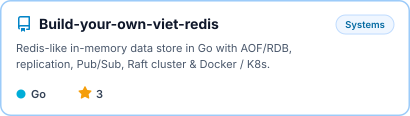
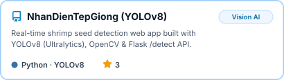
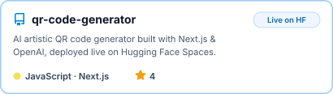
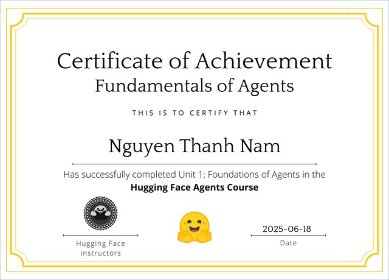
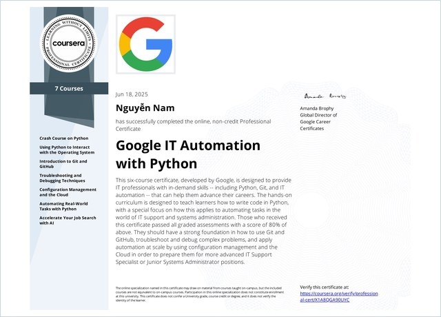
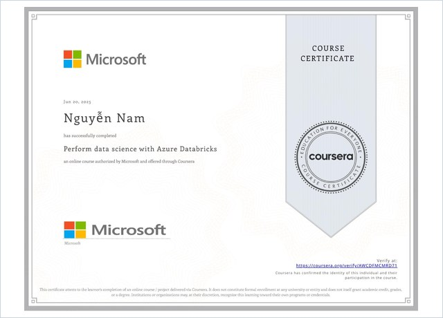
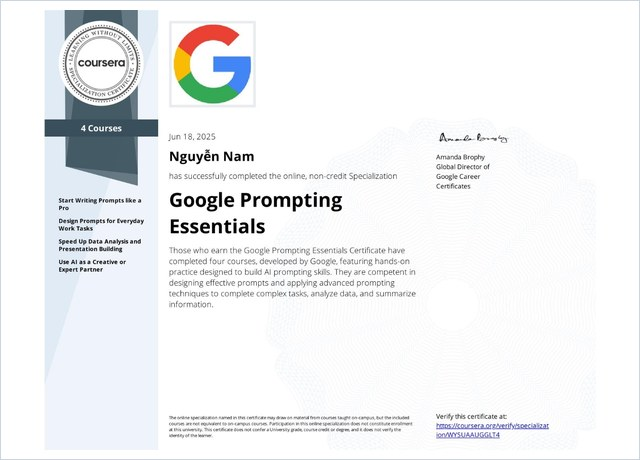
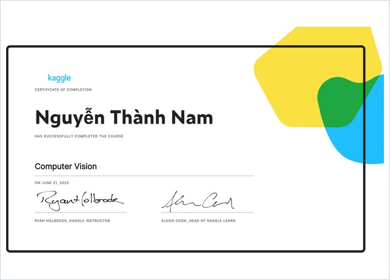
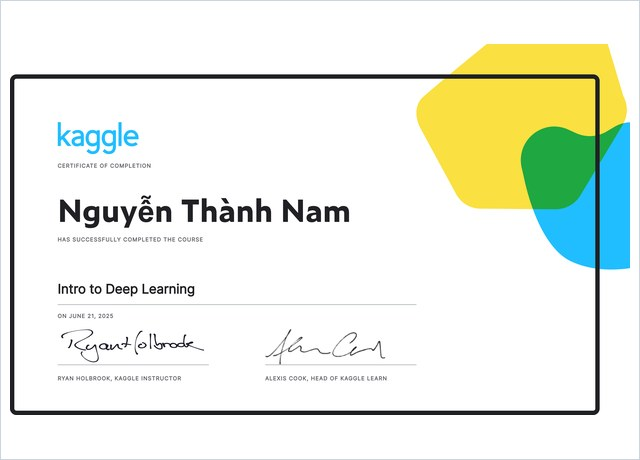

  

  
🔊 <b>Watch Intro with Sound (HD MP4)</b>

https://github.com/user-attachments/assets/b0bfd9f4-343b-479f-b534-59fddec058ce

  <picture>
    <source media="(prefers-color-scheme: dark)" srcset="https://readme-typing-svg.demolab.com?font=JetBrains+Mono&pause=1000&color=F7F7F7&center=true&vCenter=true&width=640&lines=Hi+there+%F0%9F%91%8B%2C+I%27m+Nam+(namxely);Focusing+on+AI%2FML%2C+Computer+Vision+%26+AI+Agents;CS+%40+IUH+%C2%B7+Turning+ML+Models+into+Full-Stack+Products" />
    
  </picture>

   

  
  
  
  
  
  
   
  
  
  
  
  
  
  
  
  
  
  

---

<h3 align="center">👨‍💻 About Me</h3>

  🎓 Computer Science Student @ <b>Industrial University of Ho Chi Minh City (IUH)</b> 
  🔭 Focusing on <b>End-to-End AI/ML</b> (<code>data → features → model → metrics</code>), <b>Computer Vision</b> &amp; <b>AI Agents</b> 
  ⚡ AI &amp; Software Engineer across <b>GESO</b> (AI Agent &amp; Planogram AI), <b>FPT.AI</b> (Python Data, Chatbots &amp; Tools) &amp; <b>Alchera Vietnam</b> (2D/3D CV Data) 
  🌱 Turning ML models into user-centric full-stack products with <b>FastAPI / Flask</b>, <b>React / Next.js</b> &amp; <b>Go</b>

 

  
  

### 💼 Experience

- 🤖 **Global Enterprise Solutions (GESO)** · *AI &amp; Software Engineer (6 months)* — Built and deployed an internal **AI Agent**, developed an **AI-based Display / Planogram Scoring** solution for dairy &amp; FMCG clients (**NutiFood**, **Vifon**), and contributed to **DMS** software quality assurance.
- 🐍 **FPT.AI** · *Python AI &amp; Automation Engineer (4 months)* — Engineered **Python** data processing pipelines and cleansing utilities for diverse enterprise customer datasets; developed, customized, and maintained **AI chatbots / conversational workflows** alongside internal Python automation tools to accelerate data ingestion and bot operations.
- 🎯 **Alchera Vietnam** · *AI Training Data Specialist (2 months)* — Executed high-precision **2D bounding box**, **semantic segmentation**, and **3D point-cloud / LiDAR** annotation pipelines for object detection, facial recognition, and 3D reconstruction models.

### 🌟 Featured Projects

  
  
   
  
  

#### 🤖 AI, Computer Vision & Systems

- 🦐 [**YOLOv8 Shrimp Detection**](https://github.com/namxely/NhanDienTepGiong) — Real-time computer vision app for shrimp detection with **Python**, **YOLOv8**, **OpenCV** &amp; **Flask** (`/detect` API, desktop/mobile camera support)
- ⚡ [**VietRedis**](https://github.com/namxely/Build-your-own-viet-redis) — Redis-like in-memory server in **Go** (Strings, Lists, Hashes, Sets, ZSets, AOF/RDB persistence, replication, Pub/Sub, Raft cluster, Docker/Kubernetes)
- 🎨 [**AI QR Code Generator**](https://github.com/namxely/qr-code-generator) · [Live Demo](https://huggingface.co/spaces/NamXely/ai-qr-generator) — AI artistic QR code generator built with **Next.js** &amp; **OpenAI**
- 🔊 [**Vietnamese Text-to-Speech**](https://github.com/namxely/text2speech-vi) — Web application converting Vietnamese text into natural speech

#### 🌐 Full-Stack Web Applications

- 🏥 [**HealthConnect 360**](https://github.com/namxely/KhamBenh) — Telehealth platform featuring booking, EHR, teleconsultation &amp; role-based dashboards (**React 18**, **TypeScript**, **Tailwind CSS**, **Supabase**)
- 📚 [**EduNext LMS**](https://github.com/namxely/BanKhoaHoc) — Learning Management System with Student/Instructor/Admin dashboards, course search/filter &amp; reviews (**React 18**, **TypeScript**, **Zustand**, **Vite**)
- 🏦 [**Full-Stack Banking Application**](https://github.com/namxely/UngDungfullstackNganHang) — Web banking system with auth, fund transfers, transaction history &amp; multi-role access (**PHP**, **JavaScript**, **MySQL**, **Bootstrap**)
- ✅ [**ProductivityHub**](https://github.com/namxely/ProductivityHub) — Personal productivity web app with modern glassmorphism UI (**React**, **TypeScript**, **Node.js**, **Express**, **MongoDB**)

#### 🤝 Open-Source Forks & Bilingual Labs

- 🧠 [**LLM Knowledge Base (`namxely/llm`)**](https://github.com/namxely/llm) · *MIT Fork of [WineChord/llm](https://github.com/WineChord/llm)* — Added **English &amp; Vietnamese companion roadmaps** (`README.en.md`, `README.vi.md`) and tested zero-dependency Python 3.12 labs (`labs/`: **Hybrid BM25 + TF-IDF RRF Retriever** &amp; **ReAct Tool-Calling Agent Runtime** with automated CI).
- ⚙️ [**Computer Systems Knowledge Base (`namxely/sys`)**](https://github.com/namxely/sys) · *MIT Fork of [WineChord/sys](https://github.com/WineChord/sys)* — Added **English &amp; Vietnamese systems guides** and tested zero-dependency Python 3.12 labs (`labs/`: **O(1) LRU/LFU Cache Simulator** &amp; **Streaming Redis RESP2 Protocol Decoder** with automated CI).

### 🎓 Certifications & Credentials

  <table>
    <tr>
      <td align="center" width="210">
         
        <b>AI Agents Fundamentals</b> 
        Hugging Face · <a href="https://huggingface.co/datasets/agents-course/certificates/resolve/main/certificates/nam2644/2025-06-18.png">Verify ↗</a>
      </td>
      <td align="center" width="210">
         
        <b>IT Automation with Python</b> 
        Google · <a href="https://www.coursera.org/account/accomplishments/professional-cert/certificate/X1A8QGA90UYC">Verify ↗</a>
      </td>
      <td align="center" width="210">
         
        <b>Azure Databricks Data Science</b> 
        Microsoft · <a href="https://www.coursera.org/account/accomplishments/verify/AWCDFMCMRD71">Verify ↗</a>
      </td>
      <td align="center" width="210">
         
        <b>Prompting Essentials</b> 
        Google · <a href="https://www.coursera.org/account/accomplishments/specialization/certificate/WYSUAAUGGLT4">Verify ↗</a>
      </td>
    </tr>
  </table>
  <table>
    <tr>
      <td align="center" width="210">
         
        <b>SnowPro Core Prep</b> 
        Board Infinity · <a href="https://www.coursera.org/account/accomplishments/records/151185C31Y6R">Verify ↗</a>
      </td>
      <td align="center" width="210">
         
        <b>Computer Vision</b> 
        Kaggle · <a href="https://www.kaggle.com/learn/certification/nam199245/computer-vision">Verify ↗</a>
      </td>
      <td align="center" width="210">
         
        <b>Intro to Deep Learning</b> 
        Kaggle · <a href="https://www.kaggle.com/learn/certification/nam199245/intro-to-deep-learning">Verify ↗</a>
      </td>
    </tr>
  </table>
  Full credential history on <a href="https://www.linkedin.com/in/namxely/details/certifications/">LinkedIn Certifications ↗</a>

### 🪐 Public GitHub Overview

  🔒 <i>Most of my day-to-day production engineering resides in private enterprise repositories (<b>GESO</b>, <b>FPT.AI</b>, <b>Alchera</b>). Below highlights public open-source &amp; R&amp;D activity.</i>

  
  

