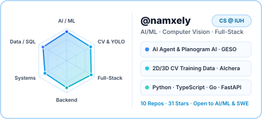

  

  <picture>
    <source media="(prefers-color-scheme: dark)" srcset="https://readme-typing-svg.demolab.com?font=JetBrains+Mono&pause=1000&color=F7F7F7&center=true&vCenter=true&width=640&lines=Hi+there+%F0%9F%91%8B%2C+I%27m+Nam+(namxely);Focusing+on+AI%2FML%2C+Computer+Vision+%26+AI+Agents;CS+%40+IUH+%C2%B7+Turning+ML+Models+into+Full-Stack+Products" />
    
  </picture>

   

  
  
  
  
  
  
   
  
  
  
  
  
  
  
  
  
  
  

---

<h3 align="center">👨‍💻 About Me</h3>

  🎓 Computer Science Student @ <b>Industrial University of Ho Chi Minh City (IUH)</b> 
  🔭 Focusing on <b>End-to-End AI/ML</b> (<code>data → features → model → metrics</code>), <b>Computer Vision</b> &amp; <b>AI Agents</b> 
  ⚡ Experienced at <b>GESO</b> (AI Agent &amp; Planogram AI) and <b>Alchera Vietnam</b> (2D/3D CV Training Data) 
  🌱 Turning ML models into user-centric full-stack products with <b>FastAPI / Flask</b>, <b>React / Next.js</b> &amp; <b>Go</b>

 

  
  

### 💼 Experience

- 🤖 [**Global Enterprise Solutions (GESO)**](https://github.com/namxely) · *Software Engineer Intern (6 months)* — Built and deployed an internal **AI Agent**, assisted in developing an **AI-based Display / Planogram Scoring** solution for dairy &amp; FMCG clients (**NutiFood**, **Vifon**), and contributed to **DMS** software testing.
- 🎯 [**Alchera Vietnam**](https://github.com/namxely) · *Data Annotation / AI Training Data Intern (2 months)* — Executed high-precision **2D bounding box**, **semantic segmentation**, and **3D point-cloud / LiDAR** labeling pipelines for object detection, facial recognition, and 3D reconstruction models.

### 🌟 Featured Projects

#### 🤖 AI, Computer Vision & Systems

- 🦐 [**YOLOv8 Shrimp Detection**](https://github.com/namxely/NhanDienTepGiong) — Real-time computer vision app for shrimp detection with **Python**, **YOLOv8**, **OpenCV** &amp; **Flask** (`/detect` API, desktop/mobile camera support)
- ⚡ [**VietRedis**](https://github.com/namxely/Build-your-own-viet-redis) — Redis-like in-memory server in **Go** (Strings, Lists, Hashes, Sets, ZSets, AOF/RDB persistence, replication, Pub/Sub, Raft cluster, Docker/Kubernetes)
- 🎨 [**AI QR Code Generator**](https://github.com/namxely/qr-code-generator) · [Live Demo](https://huggingface.co/spaces/NamXely/ai-qr-generator) — AI artistic QR code generator built with **Next.js** &amp; **OpenAI**
- 🔊 [**Vietnamese Text-to-Speech**](https://github.com/namxely/text2speech-vi) — Web application converting Vietnamese text into natural speech

#### 🌐 Full-Stack Web Applications

- 🏥 [**HealthConnect 360**](https://github.com/namxely/KhamBenh) — Telehealth platform featuring booking, EHR, teleconsultation &amp; role-based dashboards (**React 18**, **TypeScript**, **Tailwind CSS**, **Supabase**)
- 📚 [**EduNext LMS**](https://github.com/namxely/BanKhoaHoc) — Learning Management System with Student/Instructor/Admin dashboards, course search/filter &amp; reviews (**React 18**, **TypeScript**, **Zustand**, **Vite**)
- 🏦 [**Full-Stack Banking Application**](https://github.com/namxely/UngDungfullstackNganHang) — Web banking system with auth, fund transfers, transaction history &amp; multi-role access (**PHP**, **JavaScript**, **MySQL**, **Bootstrap**)
- ✅ [**ProductivityHub**](https://github.com/namxely/ProductivityHub) — Personal productivity web app with modern glassmorphism UI (**React**, **TypeScript**, **Node.js**, **Express**, **MongoDB**)

### 🎓 Coursework & Certifications

- 🤗 **Hugging Face** — AI Agents Fundamentals
- ☁️ **Microsoft / Coursera** — Perform Data Science with Azure Databricks
- 📊 **Kaggle** — Computer Vision &amp; Intro to Deep Learning
- ❄️ **Board Infinity** — SnowPro Core Certification Preparation
- ✨ **Google** — Prompting Essentials

### 🪐 GitHub Analysis

  
  

### ✅ Activity

  <picture>
    <source media="(prefers-color-scheme: dark)" srcset="https://raw.githubusercontent.com/namxely/namxely/output/github-contribution-grid-snake-dark.svg" />
    
  </picture>

### 🏆 Trophy

  

